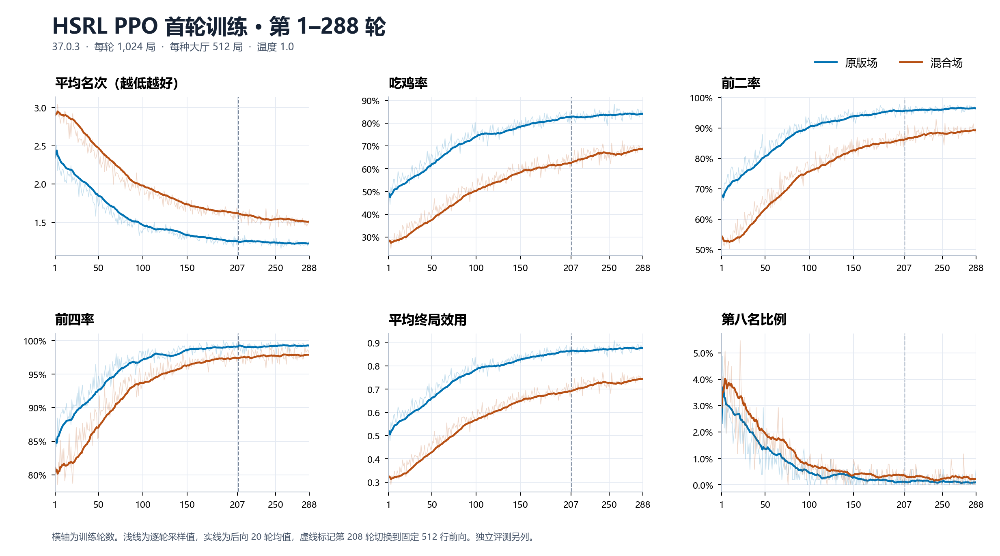
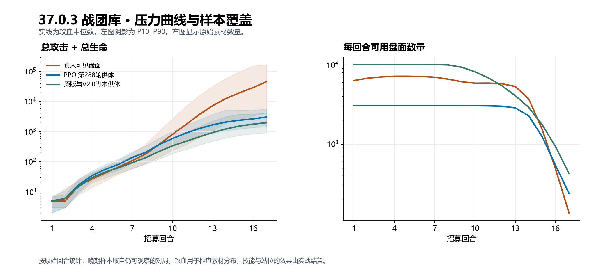

# 37.0.3 完整研究记录

本轮从 AutoTavern 上游 `1c2086a` 启动。HSRL 在 NUS 开发、构建和训练，Windows 用于文档查看、轻量验证及后续实机。主要规则、代码、测试及入口已迁入 HSRL，冻结资产保留在 NUS 独立运行目录。

## 引擎、教师和 BC

| 阶段 | 封存结论 | 详细证据 |
| --- | --- | --- |
| 模拟器 | 从 HSAI 导入已修复的 37.0.3 规则和卡表。发布验收完成 953 项 Rust release 测试及 8,192 局原版对局，另验证操作面板、实机经济标签和早先嵌套饰品回归 | [模拟器基线](../SIMULATOR.md) |
| 策略 | 迁移 V2.0 和 33 套攻略。站位版使用入场位置。16,384 对留出局对七原版，平均名次 2.221、前四 88.01%、吃鸡 51.72% | [策略教师](../STRATEGY.md) |
| BC | 12,288 局自然训练示范及学生控制下的 551,960 条纠错可选决策。18,147,729 参数模型在两种大厅各 8,192 对独立评测通过准入，冻结初始化 | [BC](../BC.md) |

两种脚本大厅分别为七原版，以及五原版与两名教师。现役教师的 33 套路线都在独立样本中至少完成过一次。策略标记、机制启动和终盘齐备各自计数，低频能力保留专项验收。

## 首轮脚本场 PPO

294,912 个训练终局、约 6,447 万条可选训练决策。第 208 轮曾因 BF16 前向形状使同权重 logp 回放偏差超过保护线而停止。用第 207 轮断点重跑，同形状与 FP32 对照定位后，采样、回放和梯度统一固定 512 行前向。第 208 至 288 轮回放误差低于 2e-6。训练至第 288 轮正常退出，开发集在六个候选中也选中该轮。

浅线为逐轮值，实线为后向 20 轮均值。原始数据见 [逐轮 CSV](../assets/ppo-training-curves.csv)。另见 [KL、熵和吞吐诊断图](../assets/ppo-training-diagnostics.png) 及 [训练配方和数值复现](../PPO.md)。

每种大厅 8,192 个独立配对种子。名次越低越好。

| 大厅 | 第 288 轮平均名次 | 前四率 | 前二率 | 吃鸡率 | BC 和 V2.0 教师平均名次 |
| --- | ---: | ---: | ---: | ---: | ---: |
| 七原版 | 1.20 | 99.34% | 97.14% | 85.31% | 2.26 / 2.23 |
| 五原版、两教师 | 1.48 | 98.14% | 90.26% | 69.37% | 2.96 / 2.92 |

混合场终局效用较 BC 提高 0.452，配对 95% 区间 [0.439, 0.464]。动作审计回放 1,536 局，复现逐局名次、动作数及回合攻血。发现 PPO 贪心样本 89 / 512 局有原地冻解往返。脚本场后期面板明显变强，严格终盘成型为 23 / 512，BC 为 40 / 512。手速亡灵出现全局 +540 攻的夺冠局，招募中的复生与魅影永久成长仍有缺口。

各大厅配对区间、升本、逐回合攻血及全部 33 套流派的汇总见 [第 288 轮独立验收详表](37.0.3-ppo288.md)。

## 战团库研究

从 Firestone 3,688 个历史原始回放审计 90,121 张盘面。真人 T8 总攻血中位数为 182，T14 为 12,823。第 288 轮模拟供体分别为 206 与 2,106。T16 后真人样本变少，晚期分层须同时考虑覆盖和实战压力。

连续模拟供体覆盖 252 种大厅。真实可见盘面按回合抽样与原局隔离。虚拟席的菜单、牌池及同回合独立供体覆盖通过修复验证。当前正常脚本路径重放 512 局、121,904 个旧动作一致。来源与回合边界见 [战团库说明](../WARBAND.md)。

短训比较四种对手环境、六种 PPO 配方，共 88 轮、45,056 局，独立验收 27,648 局。模拟混合组在真人留出场的平均名次为 4.462，第 288 轮为 4.571，纯脚本续训为 4.494。模拟混合相对纯脚本的效用差 +0.00765，95% 区间 [−0.00592, +0.02104]。终盘齐备的提升未在不同大厅普遍出现。

学习率 1.5e-5 在开发面板胜出，独立验收未复现优势。温度 1.2 或更大熵在不同大厅存在取舍。KL 开关对照最高更新 KL 为 0.00359，阈值均未触发，同学习率两侧初始与终点张量、训练轨迹摘要逐项一致。起跑采用混合环境与 7.5e-6 的保守配置。

## 九小时运行

11 月 26 日已完成整卡真实回放、Adam 续接、换配方续接和断点恢复。首轮正式训练完成 1,024 局、238,778 条决策、4,147 次战团注入。主线作业 1207511、1207512、1207513，对照作业 1207514，终点封存和汇总链 1207515、1207516、1207517。最终结论以独立验收报告为准。 [运行手册](../OVERNIGHT.md)

## 运行目录索引

以下路径相对于 NUS 的 `~/projects/HSRL/`。Git 保留代码、入口、图和轻量结果。模型、完整逐局轨迹、原始回放、训练日志和可执行构建按独立运行归档。

| 记录 | 路径 |
| --- | --- |
| 模拟器 | `artifacts/simulator/37.0.3-90ab3b92bacf/` |
| 教师 | `artifacts/strategy/37.0.3-6340a5524871/` |
| BC | `artifacts/bc/37.0.3-69011f7d5c74/` |
| PPO 原始训练、208 轮诊断、恢复 | `artifacts/ppo/37.0.3-first-training/`、`artifacts/ppo/37.0.3-replay-208/`、`artifacts/ppo/37.0.3-first-training-recovery/` |
| 288 轮独立评测及完整动作 | `artifacts/ppo/37.0.3-first-training-assessment/` |
| 战团库与短训 | `artifacts/warband/37.0.3-research-01/` |
| 九小时训练和最终结果 | `artifacts/ppo/37.0.3-warband-nine-hour-20261126/` |
