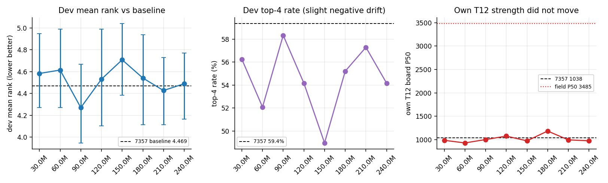
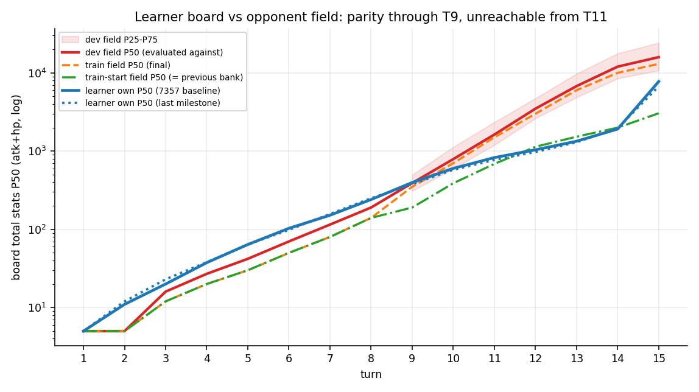
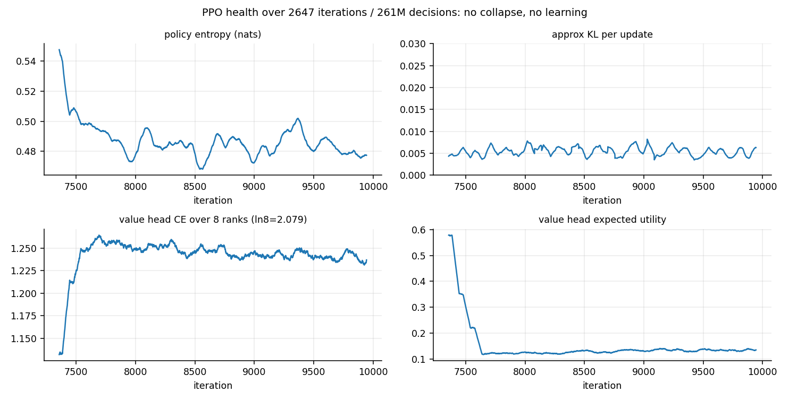
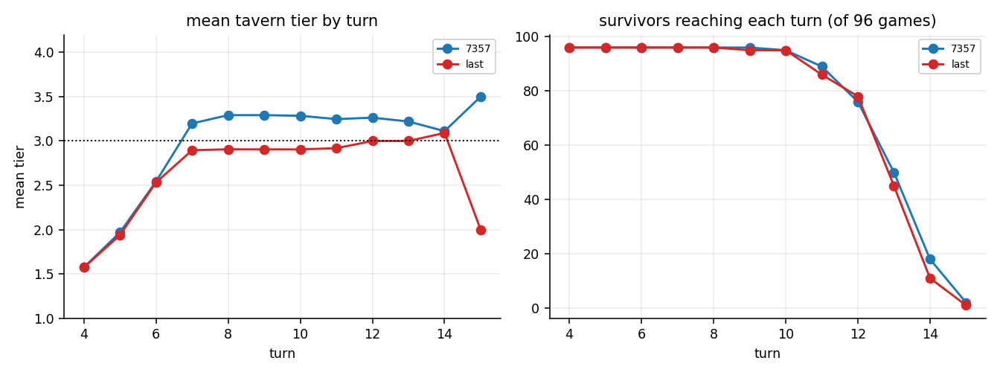
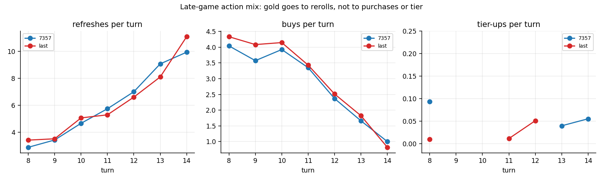
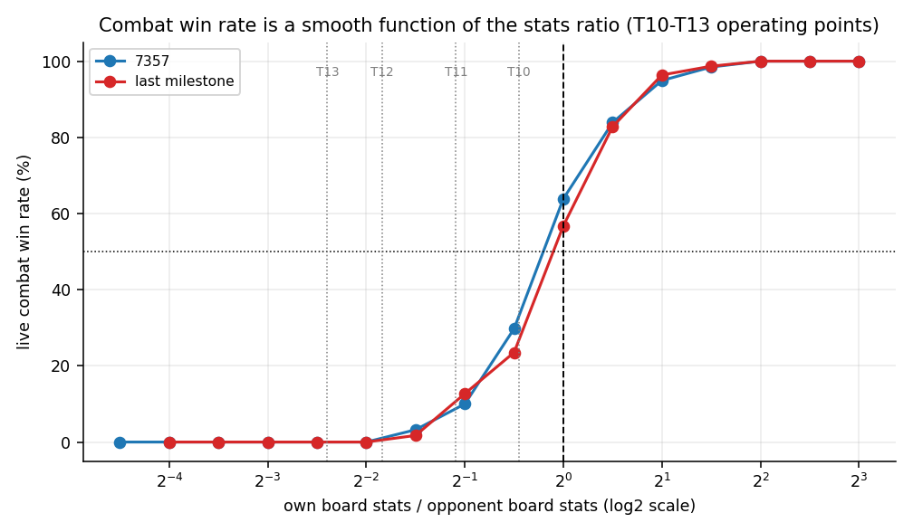

# 1085131 P50 长训复盘：为什么棋力没有提高

**范围**：NUS Job `1085131`（`p50-7357-long-001`），从 7357 完整 Trainer 起跑，新增 261,441,177 决策，最终版本 10004，于 10.2 小时后由用户安全暂停。
**证据**：`artifacts/imports/nus-1085131-closeout`（105/105 文件 SHA256 与 MANIFEST 一致，tar.gz SHA 亦一致）；全部派生统计在 `records/research/long1085131/`（脚本 `stage1`–`stage15`、`code-audit.md`、`bg-strategy-notes.md`）。
**口径**：战力一律为「每张战团总攻血 P50」，附样本量与分位；牌面 P50 不等于实战胜率，两者分开报。历史学习席牌面是 `before_end_turn`，库帧是 EOT 结算后；本轮评测已同时记录 `eot_*`，两种口径差 +4～+46 点，不影响任何结论（§3.4）。

---

## 0. 结论摘要

1. **训练工程完全干净，但没有学到东西。** 261.4M 决策、256,275 个 Adam 步、1,355,264 局，非法动作 0、截断 0、丢样本 0、活席注入 115,822,349/115,822,349 全成功、回退 0。8 个里程碑对 7357 的配对名次差均值 **+0.052**（范围 −0.198…+0.240），前四率均值 **−4.8pp**（8/8 为负），自身第 12 回合战团 P50 从 1038 变到 929–1183、无趋势（ρ=+0.17）。**结论：0 变化，且不是"略有提升"的误判。**
2. **根因不是 PPO 超参，是训练分布的难度跳变把奖励变成平台期。** 本轮把对手库第 12–15 回合的目标从 1135/1528/1992/3044 抬到 **3000/6000/10000/13000**（2.6–4.6 倍），模型自身曲线一动不动，于是自己/对手比值从 0.87–0.98 掉到 **0.26–0.16**，实战第 12 回合起胜率 **6%→0%**。伤害公式是「胜者酒馆等级 + 存活随从等级和」，**由对手棋盘决定，与自己棋盘无关**；一旦进入必败区，自身强度对名次的一阶影响归零，`∂rank/∂θ≈0`。PPO 正确地没有学到东西。
3. **模型不肯升本不是"没钱"，是"没理由"。** 升本价每回合 −1：3→4 本在第 10 回合实际只要 5 金、第 13 回合只要 2 金；第 10 回合 95/96 局在回合开始时买得起，**0 次买**。回合末剩余金币 P50=0、P90=1、全程从未 ≥8。它把每枚金币都花在当回合，因为后期已经必败，任何延后收益的投入都是纯亏。
4. **后期是"无效循环"，但那是理性反应。** 第 12 回合平均刷新 6.6–7.1 次、买 2.1–2.6 个、卖 ~1 个；第 14 回合刷新 7–11 次、买 0.8–2.2 个，刷新占全部金币支出的 84%。**85–96% 的对局在 T8 之后再也没升过本**。在第 12 回合自身 985 对上对手分布最小帧 1001 的情况下，刷新找牌确实不能改变任何结果。
5. **探索已接近 argmax。** 策略熵从首轮 0.554 降到末轮 0.471 nat（前 200 轮均值 0.522、后 200 轮 0.478），约 1.62 个有效动作、top-1≈0.92；sims=0、无 ε、无温度、behavior_mix 关、无自对弈；`entropy_coef=0.002` 只占总损失 0.2%。参数总位移仅 0.43%（相对 L2），anchor KL 从 0.134 只降到 0.112——**在抖动，没有前进**。
6. **锚点指错对象（已本地实测）。** 本轮 trainer 里的 `anchor_model` 与 7357 的 `model.pt` **不相等**（L2=9.00，max|Δ|=0.207），是更早阶段的旧策略；`anchor_beta` 的 0.1/250 调度因继承全局迭代号从未生效，全程 0.02。
7. **评测分辨率不足，必须与"没改善"分开说。** 96 局（8 座×12 seed）的簇 bootstrap 半宽 ≈0.34 名；<0.35 名的真实改善本来测不出，n<512 也永远不满足 `passed_hard_criterion`。本轮"测不出"和"确实没有"同时成立，但两者证据不同。
8. **下一轮不应继续常规 PPO 长训。** 应改为：恢复"可赢的"对手难度（约等于上一库 train-start 曲线）＋自适应加难＋给后期行为提供信用（人类后期优先/过程价值）＋评测改成"相对曲线"指标。详见 `NEXT_TRAINING_PLAN_1085131.md`。

---

## 1. 归档与训练数据核验

### 1.1 完整性

| 检查 | 结果 |
|---|---|
| MANIFEST 105 条 vs 解压文件 | 105/105 存在，**SHA256 与字节数全部一致，0 不匹配 0 缺失** |
| 单包 `HSAI-1085131-research.tar.gz` | SHA256 = `ebaef8be…e36695`，与 `.sha256` 一致 |
| 引擎/卡表指纹 | 37.0.2.256589，cards 3983，source_hash `c7b5f27d6f40d1d2`，vocab `5041e83d…`，obs 3227+124，245 动作——与仓库 `AGENTS.md` 声明的当前指纹一致 |
| 起点 | `initial_trainer.sha256=13ef5b03…`、`initial_model.sha256=60594db0…`，`cum_decisions=558,873,732`、`updates=7357`，与 `plan.json:inherited` 及本地 `artifacts/models/nus-1080772/step-007357-360m` **逐字节相同**（本地重算 SHA 一致） |
| 终点 | `latest.json` version 10004、`cum_decisions=820,314,909` = 558,873,732+261,441,177 |

### 1.2 训练数据重算

我用 `stage1_history.py` 从 2,647 行 `history.jsonl` 独立重算，并与服务器 `training-report.json` 对齐：

| 指标 | 重算 | 服务器报告 |
|---|---:|---:|
| 新增决策 | 261,441,177 | 261,441,177 |
| 进入 PPO 样本 | 261,066,811 | 261,066,811 |
| Adam 步 | 256,275 | 256,275 |
| KL 早停轮次 | 6 | 6 |
| 强制 EndTurn | 569 | 569 |
| 注入前物种偏差次数 | 22（5 个 iteration） | 22 |
| 完整对局数 | 512×2647 = 1,355,264 | 1,355,264 |

**逐字段一致。** 处理率 99.8568%，与 `learning-health.json` 的 `processed_fraction=0.99857` 相符；1 次零更新轮、1 次流水线回退、末尾连续零更新 0。

### 1.3 断点续训完整性（约 24 分钟一段，共用 26 段）

Slurm 脚本用「每段 ≤30 分钟、里程碑后 +30M 目标」的方式跑了 **26 段独立进程**（`hsai-p50-long-1085131.out` 中 26 条 `personal train` 启动行，首个 iter 分别为 7357/7445/7539/7638/7772/…/9895）。每段都以 `--checkpoint initial-state/model.pt --trainer-state initial-state/trainer.pt` 启动，因此必须排除"每段把权重重置回 7357、只续 Adam"这种致命错误。

检验：若每段重置，`anchor_kl` 会在每个段首归零后爬升，形成锯齿。实测 25 个段首的 `anchor_kl` 为 0.1088–0.1491，与前一迭代连续（如 7445 段首 0.1491、前一迭代 0.1501），**无任何锯齿**；`cum_decisions`、`updates`、`history_len` 全程单调连续。**续训状态正确。**

### 1.4 墙钟与吞吐

`totals.iteration_s=36,847.6s`（10.24 h）、采样 33,402 s、PPO 31,565 s、快照发布 2,517 s；`iteration_decisions_per_s=7,095`。该作业计划 23.5 h / 10 亿决策，实际在 10.2 h / 2.61 亿处被用户暂停，**只用了规划的 26%**。

---

## 2. 棋力为什么没有持续提高

### 2.1 全部里程碑的真实变化

固定 Dev 协议（库 `d493ef78…` = `bot-p50-3702-v1/dev`，seed 11000000，8 座×12 seed=96 局，greedy，move_cap 5），baseline 是 7357 自身。

| 里程碑（累计） | 版本 | 平均名次 | 前四率 | 夺冠 | 配对Δ名次 [95%CI] | 配对Δ前四 | 自身T12 P50 | T12 达到局数 |
|---|---:|---:|---:|---:|---|---:|---:|---:|
| 558.9M（7357 基线） | 7357 | 4.469 | 59.4% | 1.0% | — | — | 1038 | 76 |
| 588.9M | 7638 | 4.583 | 56.3% | 0.0% | +0.115 [−0.260,+0.448] | −3.1pp | 985 | 79 |
| 618.9M | 7945 | 4.615 | 52.1% | 1.0% | +0.146 [−0.135,+0.427] | −7.3pp | 929 | 75 |
| 648.9M | 8255 | 4.271 | 58.3% | 1.0% | **−0.198** [−0.615,+0.271] | −1.0pp | 1001 | 79 |
| 678.9M | 8561 | 4.531 | 54.2% | 2.1% | +0.063 [−0.260,+0.417] | −5.2pp | 1075 | 75 |
| 708.9M | 8865 | 4.708 | 49.0% | 0.0% | +0.240 [−0.073,+0.552] | **−10.4pp** | 974 | 75 |
| 738.9M | 9171 | 4.542 | 55.2% | 3.1% | +0.073 [−0.281,+0.458] | −4.2pp | 1183 | 79 |
| 768.9M | 9479 | 4.427 | 57.3% | 0.0% | −0.042 [−0.292,+0.219] | −2.1pp | 994 | 78 |
| 798.9M | 9786 | 4.490 | 54.2% | 1.0% | +0.021 [−0.219,+0.260] | −5.2pp | 974 | 78 |

- 名次差均值 **+0.052**（sd 0.131），前四差均值 **−4.8pp**，8/8 为负。
- 名次与里程碑序号的秩相关 **ρ=−0.36**、前四 ρ=−0.05、自身 T12 P50 ρ=+0.17：**都没有趋势**。
- 前四率 8 次全负，是"轻微退化"的弱但一致信号；但每次的配对 CI 都跨 0（12 簇 bootstrap），**不足以断言退化**。

**判读**：真实情况是"零变化"：模型在 261M 决策里既没有前进也没有明显退步，最终 10004 与 7357 在统计上不可区分（小于评测分辨率 0.34 名）。选哪个做下一轮起点，**不由这 8 个里程碑决定**（理由见 `NEXT_TRAINING_PLAN_1085131.md` §1）。

### 2.2 名次分布的形状：一个"安全的中庸玩家"

7357 与最后一版的 96 局名次计数：`{1:1,2:2,3:16,4:33,5:26,6:12,7:4,8:2}`（基线 `{1:1,3:23,4:33,5:15,6:18,7:4,8:2}`）。分布集中在 3–5 名，**几乎没有第一，也几乎没有第八**。这不是"运气不好"，而是策略在最大化（线性）名次效用时的风险结构：它把方差压到最小，只在确定能活的时候活，不去争第一。

因为名次效用 `u(r)=1−2(r−1)/7` 是**线性**的，风险中性最优策略应该愿意用第八换第一；观测到的风险厌恶是**名次对行为不敏感**的副产物，而不是偏好。

### 2.3 波动来自哪里

- 96 局的名次标准误 ≈ 2.0/√96 = 0.20；配对后（同 96 局、注入端 CRN）降到 0.13–0.15。里程碑之间 ±0.24 的摆动已接近这个量级，**不应当作棋力变化解读**。
- 12 簇 bootstrap 给出 ±0.34 的半宽，是因为只有 12 个独立种子簇（每簇 8 局相关）。要分辨 0.2 名需要 ≥512 局（与 `paired_panel_delta.py` 的 n≥512 门槛一致）。

---

## 3. 战团库是否合理

### 3.1 四阶段课程确实按规格执行了

| 阶段 | 库摘要 | curriculum_progress | 切换版本 | 累计决策 | 新决策 |
|---|---|---:|---:|---:|---:|
| 1 | `d2f4a8c1`（train-start） | 0.0 | — | 558.87M | 0 |
| 2 | `210eb001`（ramp1） | 1/3 | 7445 | 568.95M | 10.08M |
| 3 | `ab42bd44`（ramp2） | 2/3 | 7539 | 578.94M | 20.07M |
| 4 | `04359ca4`（train） | 1.0 | 7638 | 588.93M | 30.07M |

逐回合 P50 也严格按线性插值：例如 T12 为 1135 → 1757 → 2378 → 3000（`1135+(3000−1135)/3=1756.7`）。**课程机制没有问题，问题在课程内容。**

### 3.2 三条曲线的绝对水平（这是核心事实）

| 回合 | train-start（上一库实测） | **train（本轮目标）** | **dev（评测）** | train 相对 train-start |
|---:|---:|---:|---:|---:|
| 6 | 50 | 50 | 70 | 1.0× |
| 8 | 140 | 140 | 190 | 1.0× |
| 9 | 190 | 350 | 390 | 1.84× |
| 10 | 388 | 700 | 790 | 1.80× |
| 11 | 686 | 1500 | 1625 | 2.19× |
| 12 | 1135 | 3000 | 3485 | **2.64×** |
| 13 | 1528 | 6000 | 6765 | **3.93×** |
| 14 | 1992 | 10000 | 12000 | **5.02×** |
| 15 | 3044 | 13000 | 15865 | **4.27×** |

**前 8 回合不变，第 9 回合起陡升，第 12–15 回合是 2.6–5.0 倍。** 也就是说：这一轮并没有"降低压力"，而是把中后期对手强度整体抬了 3 倍左右，而且过渡只占 30M/261M = **11.5%**。

### 3.3 模型的自身曲线完全没动，于是比值崩溃

| 回合 | 自身 P50（7357） | 自身 P50（最后一版） | train-start 比值 | train 比值 | dev 比值 | 在 dev 分布中的分位 |
|---:|---:|---:|---:|---:|---:|---:|
| 7 | 152 | 157 | 1.90 | 1.96 | 1.37 | 83% |
| 8 | 240 | 250 | 1.71 | 1.79 | 1.31 | 78% |
| 9 | 396 | 377 | 2.08 | 1.08 | 0.97 | 46% |
| 10 | 601 | 577 | 1.55 | 0.82 | 0.73 | 24% |
| 11 | 826 | 772 | 1.20 | 0.51 | 0.47 | 12% |
| 12 | 1038 | 974 | 0.91 | 0.32 | 0.28 | **0%** |
| 13 | 1336 | 1300 | 0.87 | 0.22 | 0.19 | **0%** |
| 14 | 1912 | 1951 | 0.98 | 0.20 | 0.16 | **0%** |

三条独立证据说明"从第 11–12 回合起完全打不过"：

1. **分位归零**：第 12 回合自身 P50=985（EOT 口径；`before_end_turn` 口径为 974），而 dev 库 256 帧的**最小值是 1001**、P25 是 2622。模型的中位战团在对手支持集的**下界之外**。
2. **实战胜率归零**：逐回合活席胜率 T8 0.71–0.77 → T10 0.31–0.48 → T11 0.17–0.33 → **T12 0.00–0.06 → T13 0.00–0.06 → T14 0.00**。
3. **伤害与血量轨迹**：失败时受伤 T10 13.3 → T12 18.5 → T13 23.8 → T14 27.1（第 8 回合上限 15，≤4 人时解除上限）；英雄血量 P50 从 T10 的 30 掉到 T12 的 18、T13 的 10。

### 3.4 EOT 与 before_end_turn 的口径修正（已做）

上一轮复盘指出"历史学习席战力采于 `before_end_turn`，库是 EOT 结算后，不能直接比"。本轮评测同时记录了 `eot_board` 与 `eot_p50_strength`（`eot_missing=0`）。实测两者差 +4～+46 点（T8 +4、T9 +20、T10 +19、T12 +10、T13 +46），**结论不变**：以 EOT 口径，T12 自身 985、dev P50 3485、比值 0.28。此后所有比值优先用 EOT。

### 3.5 库本身的额外偏差：注入目标用的是"回放主"的 P50，不是"对手"的 P50

Firestone 20261106 快照的逐回合表同时给了 `self_p50` 与 `opponent_p50`：

| 回合 | 总体 p50（=库目标） | self_p50 | **opponent_p50** | 库目标 ÷ opponent_p50 |
|---:|---:|---:|---:|---:|
| 10 | 789.5 | 1071.5 | **649** | **1.22×** |
| 12 | 3487.5 | 5074.0 | **2467** | **1.41×** |
| 14 | 12004 | 18750.5 | **7024** | 1.71× |

库的目标取自"总体 p50"，而总体 p50 介于 self 与 opponent 之间；**真正模拟"其余 7 个座位"应当用 `opponent_p50`**。也就是说，即使不看 3 倍跳变，注入场也比"同龄真实对手"强 22%（T10）到 41%（T12）。

⚠️ 两个限制：该表来自 255790 旧补丁（不是 256589）；精彩对局筛选使 self>opponent 成为必然。这只影响"偏强多少"的系数，不影响"偏强"的方向。

### 3.6 库的其它质量项（结论：可用）

- 校准达成度：train/dev/test 每回合 P50 **精确等于目标**（T12 3000/3485/3485），P25/P75/P90/min/max 一致；`validation.checked=accepted`，quarantined 0；`dropped_small_boards={11:1,12:1}`（低于"≥5 随从"门槛被丢弃），`tail_reserve` 只在 T19 出现。
- 样本量：Train 2048 源局、每回合 1024 帧；Dev/Test 各 256 源局、每回合 256 帧；**晚回合迅速变稀**（T14 240、T15 180/161、T16 90、T17 47、T18/19 47），T17 起统计噪声大。
- 随从构成：T10–T14 实际面对的战团**7 个随从**、单怪占全部攻血的比例 P50 0.31–0.34、>60% 的只有 1–10%、>75% 的 0%。**"一个巨型单怪"的担忧在这批帧上不成立**（`calibration.json` 里的 `max_body_share` 0.72–0.87 是库内最大帧，不是常态）。
- 机制保真：注入保留金色、站位、关键词、手牌队列；`mirror_applied_with_hand_queue` 每库 1–2 次，严格审计 0 拒绝。
- 但**牌面 P50 被按比例重写**（`buff_share≈0.01`、`pbonus≈0`），所以"对手是 tier 4–6 的真实身材"不成立：它只是把真实战团的比例缩放到了目标总量。这解释了为什么对手的中位随从等级只有 3.6–4.1，却拥有 3500–12000 的总攻血。

**判断：库的工程质量合格，但"绝对强度目标"与"注入目标口径"两处都系统性偏强。** 需要降低压力，并且不能再用"总体 P50"当对手强度。

---

## 4. PPO 是否存在学习瓶颈

### 4.1 训练健康度：没有任何崩溃

| 指标 | 前 200 轮 | 后 200 轮 | 全程范围 |
|---|---:|---:|---|
| 策略熵（nats） | 0.522 | 0.478 | 0.459–0.558 |
| approx KL/更新 | 0.00486 | 0.00542 | 0.0011–0.0754 |
| clip 比例 | 0.0456 | 0.0445 | ≤0.189 |
| 价值 CE（8 类） | 1.181 | 1.240 | 1.14–1.29 |
| 价值期望效用 | 0.439 | 0.135 | — |
| adv_std | 0.205 | 0.211 | — |

没有熵塌缩到 0、没有 KL 爆炸、没有大量零更新（1 次）、早停只有 6/2647 次（阈值 1.5×target_kl=0.075）。**"PPO 调参能救"这一假设，被这些数据否掉了大半**：它没有坏，它只是没有信号。

但有三个真实的结构问题，任何一个都足以让 261M 决策原地踏步：

**(a) 信用分配是"整局一个标量"。** 奖励只在末步写入 `u(rank)`（`ppo.py:1713`），其余 ~189 条决策 reward=0；γ=1、λ=0.995 使 `(γλ)^lag` 在 lag=100 时 0.606、lag=190 时 0.386、全程平均 0.642。**第 6 回合"要不要升本"和第 15 回合"卖谁"拿到的是同一个标量**。名义上这不是稀疏奖励，实际上它是"以 V 为基线的整局 REINFORCE"。

**(b) 价值基线弱且停止学习。** 价值头是 8 类名次交叉熵（`ppo.py:2521`），CE 从 1.145 反而升到 1.240——在 2647 轮里**没有任何改进**；期望效用 0.131，而实测均名 4.469 对应 u=0.009，critic 系统性乐观 0.12。CE 停在 1.24（均匀是 2.079）意味着"critic 认为结局仍然高度不确定"，这与"名次对该状态几乎不可预测"是一致的——**这本身就是平台期的症状，不是原因**。

**(c) 探索已接近 argmax。** 熵 0.471 nat ⇒ 有效动作数 e^0.471≈1.62、top-1≈0.92；sims=0、无 ε、无温度、`behavior_mix` 关闭、无自对弈。`entropy_coef=0.002` 对总损失贡献 −0.001（<0.2%）。**策略不可能自发离开"贪当回合经济→tier 3→后期必败"的局部最优**，因为离开需要连续几十步的协调偏离。

### 4.2 位移量级：等于"几乎没动"

本地加载 7357 与 10004 的完整 trainer 实测（16.95M 参数）：

| 对比 | L2 | 相对 |
|---|---:|---:|
| model(10004) vs model(7357) | 3.98 | **0.43%** |
| anchor(10004) vs model(7357) | 9.00 | —（不相等） |
| anchor(7357) vs anchor(10004) | 0.0000 | 完全相同 |

`anchor_kl` 从 0.1340 只降到 0.1124（净 −0.022 nat），而每轮 approx_kl 是 0.005 ⇒ 2647 轮的步长总和是 13 nat，净位移 −0.022 nat：**方向近乎零均值**。

### 4.3 两个应该修的工程缺陷（与算法配方无关）

1. **anchor 指向更早的旧策略，不是 7357。** `ppo_trainer.load_state_dict` 优先恢复 state 里的 `anchor_model`（`ppo_trainer.py:446-448`），而不是在 fork 时重建。我在本地验证：7357 的 trainer 与 10004 的 trainer 的 anchor 逐张量相同，且与 7357 的 `model.pt` 不等（L2 9.00、max|Δ|=0.207）。所以本轮"KL 拉回 stage 起点"的意图没有实现，实际是"拉回某个更早、更弱的策略"。
2. **`anchor_beta 0.1 → 0.02`（250 轮）从未生效。** 调度用**全局** iteration 号判断 `i<250`，本轮 i 从 7357 起 ⇒ 第一轮就是 0.02。同理，lr 调度器也继承 b10m 的计数器：起点 1.7547e-6，到 iteration 10000 触底 1.6667e-6 后**永久钉在地板**，全程只衰减 5%。

### 4.4 该不该提高学习率？

**证据不支持"提高 lr 会解决问题"，但支持"当前 lr 下位移太小"这一事实。**

- 支持提高的理由：256k 步只移动 0.43%，anchor KL 只变 0.022 nat；若目标是"让策略真正离开 7357"，当前 lr 明显偏保守。
- 反对的理由：真正的问题是优势信号在后期约为 0（§5），提高 lr 只会把噪声放大成更大的抖动；`clip_frac` 只有 4.4%、KL 只有 0.005，说明**不是被 clip/KL 卡住**，而是梯度本身没方向。
- 结论：lr 可以提高（2–5 倍量级），但**只能作为"信号修好之后"的加速器，不能当作补救**。必须与难度/信用修复同时上，并且要用小实验单独验证（`NEXT_TRAINING_PLAN` §4 的 E3）。

---

## 5. 模型为什么不愿意升本

这一节是本次复盘最重要的机制结论，全部有数据支撑。

### 5.1 升本并不贵，而且越晚越便宜

引擎规则（`engine/.../config.rs:246`、`flow.rs:391`）：升本基价 `[5,7,8,11,11,10]`（2–7 本），**每回合自动减 1，升本后重置到下一级基价**。因此：

- 常规线：T2 升 2 实付 4、T5 升 3 实付 4、T7 升 4 实付 6、T8 升 5 实付 10、T10 升 6 实付 9–10（前 10 回合金币合计 72，升本占 33–34 ≈ 46%，是全局最大的单笔投资）。
- 本模型的实际路径：T7 用 4 金升到 3 本（66% 的局），之后 3→4 本的价格变为 8，然后 **T8 7、T9 6、T10 5、T12 3、T13 2、T14 1**。
- 第 10 回合收入 10 金，升本要 5 金（按 T7 用 4 金升到 3 本的常见路径：下一级基价 8，此后每回合 −1，T8 7 / T9 6 / T10 5）；**95/96 局在回合开始时买得起**（`upgrade_legal_steps>0`），实际升 **0 次**。第 12 回合只要 3 金，升 0–4 次。

**"没钱/买不起"这个解释被直接否掉。**

### 5.2 真正的机制：它从不跨回合存钱，所以"选项"每回合都被自己花掉

| 回合 | 回合末金币 P50 / P90 / 最大 | 金币≥8 比例 | 升本可负担局数（基线 / 8 档范围） | 实际升本局数（基线 / 8 档范围） |
|---:|---|---:|---|---|
| 7 | 0 / 1 / 2 | 0% | 96/96 · 94–96 | 63 · 22–41 |
| 8 | 0 / 1 / 2 | 0% | 90/96 · 90–94 | 9 · 1–7 |
| 9 | 0 / 1 / 3 | 0% | 81/96 · 86–93 | 0 · 0–1 |
| 10 | 0 / 1 / 2 | 0% | 95/96 · 94–96 | **0** · 0–2 |
| 11 | 0 / 1 / 2 | 0% | 89/96 · 86–93 | 0 · 0–3 |
| 12 | 0 / 1 / 2 | 0% | 76/96 · 75–79 | 0 · 0–4 |
| 13 | 0 / 1 / 2 | 0% | 50/96 · 43–54 | 2 · 0–2 |

**9 份评测合计约 1.07 万个回合里，回合末金币从未达到 8。** 升本是要在回合内一次性付清的（不能分期），而策略每回合都把金币立刻换成"当回合的战力"。所以它并非"评估后拒绝升本"，而是**在每个回合的开始就把升本的选项花掉了**——一个典型的多步承诺/期权问题，单步贪心策略天然学不到。

### 5.3 为什么"立刻花掉"是理性的

因为后期已经必败（§3.3）：T12 起胜率 0–6%，而升本的全部收益在 T11–T15 才兑现。**在"活不到兑现"的状态分布里，升本的期望收益是负的**（少买 2 个随从 → 少 60 点身材 → 掉血更快 → 名次更差）。策略梯度正确地学到了"别升本"。

这意味着：**"不升本"不是需要奖励去纠正的坏习惯，而是当前课程下的最优反应。** 换掉奖励、加升本 bonus、强行惩罚不升本，都会与真实回报打架——仓库自己的 A/B 已经证明过：`tier_target_coef=1`（bonus 0.15/penalty 0.02）在 1.6M 决策内**完全没有改变 tier 行为**，coef=10 能推动 tier 但 human 面板没有改善（`records/source-docs/hsbg/docs/TIER_TARGET.md` §7–8）。

### 5.4 附带证据：对手的等级比它高 1–1.5 级

实测双方战团里随从的酒馆等级分布：

| 回合 | 自身随从等级均值 | 自身 tier≥5 占比 | 对手随从等级均值 | 对手 tier≥5 占比 | 对手 tier≥6 占比 |
|---:|---:|---:|---:|---:|---:|
| 8 | 2.41 | 2.7% | 2.99 | 6.0% | 0.6% |
| 10 | 2.73 | 6.5% | 3.64 | 23.2% | 6.0% |
| 12 | 2.75 | 9.9% | 4.08 | 40.7% | 17.3% |
| 13 | 2.79 | 11.0% | 3.95 | 39.1% | 20.2% |

对手在第 10 回合就已经是"tier 4–6 的随从组合"，模型还在用 tier 3 的商店。**等级差就是身材差的来源**：tier 3 商店的天花板约 1,000–1,300 总攻血，这与实测的 T12–T13 自身曲线（985/1300）完全吻合。

---

## 6. 后期成长为什么不足 / 训练与评测是否有偏差

### 6.1 行为画像：刷新—买—卖的循环

| 回合 | 自身 P50 | 平均刷新 | 平均购买 | 平均卖出 | 平均打出 | 平均金币支出 | 其中刷新金币 | 刷新占比 |
|---:|---:|---:|---:|---:|---:|---:|---:|---:|
| 8 | 250 | 3.43 | 4.33 | 1.29 | 6.38 | 12.4 | 2.6 | 21% |
| 10 | 577 | 5.07 | 4.15 | 1.58 | 6.31 | 13.1 | 4.2 | 32% |
| 11 | 772 | 5.30 | 3.43 | 1.19 | 5.08 | 12.5 | 4.7 | 37% |
| 12 | 974 | 6.62 | 2.51 | 1.10 | 4.28 | 12.4 | 6.1 | 49% |
| 13 | 1300 | 8.11 | 1.82 | 0.69 | 2.69 | 12.2 | 7.8 | 64% |
| 14 | 1951 | 11.09 | 0.82 | 1.27 | 3.18 | 13.1 | 11.0 | 84% |

（最后一版 v798873732；基线 7357 的同表数值几乎相同，T14 刷新 9.94、购买 1.00。）

- 每回合收入约 10 金 + 卖出回收 1 金，支出 12.2–13.1 金，**回合末金币 P50 恒为 0**。
- **刷新支出占全部支出的比例：T10 32% → T12 49% → T13 64% → T14 84%**；购买从 4.15 掉到 0.82。
- 棋盘数恒定 6.8–7.0，所以"买"必须先"卖"；T12 之后是"卖 1 个、买 1–2 个"的换手。
- 第 8 回合之后再升本的局数：`upgrades_T8plus` 每局均值 0.06–0.15，**85–96% 的局为 0**。

**这是"没有收益的刷新"吗？** 在当前难度下是的：刷新只能找到 tier 3 的牌，天花板 1,000–1,300，而对手是 3,500–12,000。所以模型并没有"浪费"金币——它只是在一个没有任何投资能改变结果的环境里，把金币换成了当回合最大化的血量/名次保险。

### 6.2 名次对自身强度的敏感性（奖励的信息量）

| 指标 | 7357 基线 | 最后一版 |
|---|---|---|
| 名次 vs T10 战团强度 Spearman ρ | −0.42 | −0.34 |
| 名次 vs T12 战团强度 ρ | −0.29 | −0.25 |
| 名次 vs 酒馆等级 ρ（T8/T10/T12） | +0.02 / −0.01 / −0.04 | −0.02 / −0.03 / −0.05 |
| R²（名次~T10 强度） | 0.17 | 0.12 |

- 自身强度只解释名次方差的 **9–17%**；酒馆等级几乎解释不了任何东西（因为大家在 T12 都是 3 本）。
- 名次几乎完全由"死在第几回合"决定：**结束回合 T10→6.5 名、T11→5.4/5.7、T12→4.5、T13→4.0、T14→3.3/3.6**（每多活一回合≈升 1 名）。
- 而"死在第几回合"由血量与固定伤害序列决定；伤害公式是「胜者酒馆等级 + 存活随从等级和」，**与自己棋盘无关**（`combat.rs:20,282`）。所以在必败区，自身强度对名次的影响是**二阶**的（只通过"这回合是否翻盘"），而在 0% 胜率下这个通道也被关闭。

**这就是奖励的平台期**：模型的可控量与奖励之间没有连续通路。把 T12 从 974 提到 1,200（+23%）不会改变任何一场战斗的胜负，也不会改变掉血，因此优势函数对该动作的导数为 0。

### 6.3 还有多少"以弱胜强"的余地

实战胜率 vs 双方总攻血比值（1,145 场活席战斗，最后一版）：

| 比值区间 | <0.3 | 0.3–0.5 | 0.5–0.7 | 0.7–0.9 | 0.9–1.1 | 1.1–1.5 | >1.5 |
|---|---:|---:|---:|---:|---:|---:|---:|
| 胜率 | 0% (n=103) | 2% (85) | 11% (76) | 30% (111) | 56% (139) | 78% (222) | 95% (407) |

- 50% 胜率大约在比值 **0.9**。模型在 T10 处于 0.73、T11 0.47、T12 0.28、T13 0.19——**越走越远，而不是越来越近**。
- 战术（圣盾+剧毒 ≥2 个随从）能把同样的身材差换成更高的胜率：比值 0.7–0.9 时 40% vs 无战术 9%；0.9–1.1 时 69% vs 29%。**但比值 <0.5 时战术完全无效（0–2%）**。模型已经常备 2.3–2.6 个圣盾、0.5–0.6 个剧毒，**战术不是缺失项**，它缺的是把比值从 0.3 拉回 0.9。

### 6.4 训练与评测的四处偏差（回答"是否在优化错误目标"）

1. **奖励没有偏差，但信息量不足**：奖励就是终局名次 utility，没有塑形、没有升本/牌面奖励（`shaping_coef=0`、`tier_target_coef=0`、`terminal_strength_coef=0`），`mean_utility=0.009` 与名次 4.469 自洽。**不存在"奖励被刷"的问题，存在"奖励对行为不敏感"的问题。**
2. **train / dev 是两条曲线，dev 系统性更难**：dev/train = 1.33 (T3)、1.40 (T6)、1.36 (T8)、1.13 (T10)、1.16 (T12)、1.20 (T14)。所以 dev 名次是"对外部更难曲线的泛化"，不是训练目标；这本身可接受，但它同时意味着"dev 不动"有一部分是**评测点选得太远**。
3. **注入强度用错了统计量**（§3.5）：目标取"总体/回放主 P50"，比"对手 P50"高 22–41%。
4. **评测分辨率不足**：96 局、12 簇 bootstrap 半宽 ≈0.34 名、前四 ±13pp；`passed_hard_criterion` 要求 n≥512，因此永远不会通过。**8 个里程碑的"没有改善"在这套协议下与小改善不可区分**；前四率 8/8 为负是本轮唯一方向一致的信号（−4.8pp）。

另外两点需要澄清（避免后续误判）：

- 评测不是"只评 seat 0"：`personal.py` 对 8 个座位各评 12 局（每次只有一个座位是学习者），而训练永远只有 seat 0 是学习者。7/8 的评测局落在"训练中从未出现过的座位"上，但逐座位均名 4.17–4.75、12 局/座的噪声 ±0.6，看不出系统性优势或劣势。
- `mirror_pool_species_preexisting=22`（5 个 iteration）是"注入**之前**引擎池账本已不守恒"的计数，`pool_species_unbalanced=0`（注入没有改变它），质量门只拦后者。**不是本轮的数据损坏，也不是主因**；上一轮的 71 同义。

---

## 7. 归因分层

### 7.1 已由数据证实

| # | 结论 | 证据 |
|---|---|---|
| F1 | 261M 决策没有产生可测的棋力变化 | 8 个里程碑配对 Δ 均值 +0.052、自身 T12 曲线无趋势、参数位移 0.43% |
| F2 | 本轮对手中后期强度是上一库的 2.6–5.0 倍 | 两条 calibration 曲线逐回合对比；课程 4 段按规格执行 |
| F3 | 第 12 回合起自身战团低于对手分布下界，实战胜率 0–6% | dev 库 min=1001 vs 自身 985；exposure 胜率 |
| F4 | 伤害由对手棋盘决定，自身棋盘不进入伤害公式 | `combat.rs` 公式 + 失败时受伤单调随对手强度（13.3→27.1） |
| F5 | 名次≈由"死在第几回合"决定，强度只解释 9–17% 方差 | 结束回合一↔名次表；Spearman −0.25…−0.42 |
| F6 | 升本不贵（T10 5 金、T13 2 金）且回合初可负担，模型 0 次执行 | `upgrade_legal_steps` 94–96/96 vs `upgrade_taken` 0 |
| F7 | 模型从不跨回合留钱（回合末金币从未 ≥8） | 9 份评测约 1.07 万回合的 gold 分布 |
| F8 | 探索接近 argmax，且没有任何其它探索源 | 熵 0.471 / top-1≈0.92；sims=0、无 ε/温度/mix/自对弈 |
| F9 | anchor 不是 7357，`anchor_beta` 0.1 从未生效，lr 计数器继承 | 本地张量比对（L2=9.00）；history 的 anchor_coef 首轮 0.02 |
| F10 | 评测分辨率 ≈0.34 名，n<512 永不通过门禁 | 12 簇 bootstrap；`paired_panel_delta` 的 n≥512 条件 |

### 7.2 合理推测（有机制解释，但需实验）

| # | 推测 | 机制与理由 |
|---|---|---|
| H1 | 若把后期对手降到"可赢"区间，模型会开始升本并学会后期 | 比值回到 0.85–1.0 时胜率 35–55%，强度重新变成名次的连续函数；仓库自己的 `BoardRampController` 注释就写明"对手太强 → 活不到后期 → 学不到缩放" |
| H2 | 单纯提高 lr / 降低 entropy 不会带来成长 | 优势在后期≈0，放大梯度只会放大抖动 |
| H3 | 单靠"升本奖励"无效甚至有害 | 仓库 A/B：coef=1 无行为变化；coef=10 推动 tier 但 human 面板无改善 |
| H4 | 后期需要人类/教师先验，否则多步协调策略无法被随机探索发现 | 从"tier 3 + 全花光"到"tier 5 + 留钱 + 找引擎"需要连续几十步正确偏离 |
| H5 | 价值目标占据损失 99%、策略头位移 <2%，trunk 主要被名次预测塑形 | 损失量级实测（policy 0.0027 / value 0.6225 / anchor 0.0022 / entropy 0.0010），梯度占比待测 |

### 7.3 仍需实验验证

- 采样温度 1.5–2.0 下策略是否会出现"tier 4/5 线"（区分"没有偏好"与"偏好被塌缩掩盖"）。
- 把 minibatch 1024→4096 后优势噪声是否下降（每步 5.3 局 → 21 局）。
- 用 `opponent_p50` 校准的同一检查点评测名次会改善多少（量化 §3.5 的偏差）。
- 反传时 policy / value / anchor 三项对 trunk 的 grad-norm 占比。

---

## 8. 本次复盘修正的两个历史口径

1. **"7357 的 dev 是 3.667"与"7357 的 dev 是 4.469"都对，但不可比。** 前者在旧库（均值校准、255790 来源）评测，后者在新 P50 库（`d493ef78`）评测。同一个 7357 模型在换库后名次从 3.667 变成 4.469，**这是场地的变化，不是模型的退化**。以后跨库的绝对名次禁止对比。
2. **上一轮 71 次物种偏差 vs 本轮 22 次**：口径相同，但**71 属于 1080772**，不能记到本轮。

---

## 9. 一页纸答案

| 问题 | 回答 |
|---|---|
| 棋力为什么没有持续提高？ | 因为这一轮把对手中后期强度抬了 2.6–5 倍，而模型第 12 回合起就在对手分布下界之外，实战 0 胜率；在必败区，伤害与自己棋盘无关，名次对成长不敏感，`∂rank/∂θ≈0`，PPO 正确地不再学习 |
| 战团库是否合理？ | 工程质量合格（校准精确、注入 100%、0 拒绝），但绝对强度与"用总体 P50 当对手"两处系统性偏强 22%–41%，且 3 倍跳变只给了 11.5% 的过渡 |
| PPO 是否有瓶颈？ | 没有崩溃，但三个结构瓶颈真实存在：整局一个标量（有效信用权重 0.64）、价值基线停在 CE 1.24、探索塌缩到 top-1≈0.92；外加两个工程缺陷（anchor 指错、lr/anchor 调度继承） |
| 为什么不愿升本？ | 不贵（T10 5 金、T13 2 金）且买得起（94–96/96 局）；但它从不跨回合留钱（回合末金币 P50=0），且升本的收益在"活不到"的回合兑现，所以不升是当前课程下的理性最优 |
| 后期成长为什么不足？ | tier 3 商店的天花板 ≈1,000–1,300，正好等于实测自身 T12–T13 曲线；对手在第 10 回合已经是 tier 4–6 组合。缺陷不在刷新，而在等级 |
| 训练/评测有偏差吗？ | 奖励无偏但信息量低；dev 比 train 难 13–40%；注入目标用了错误的统计量；评测 0.34 名分辨率，"测不出"与"没改善"必须分开 |
